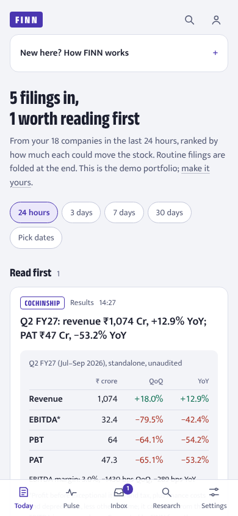
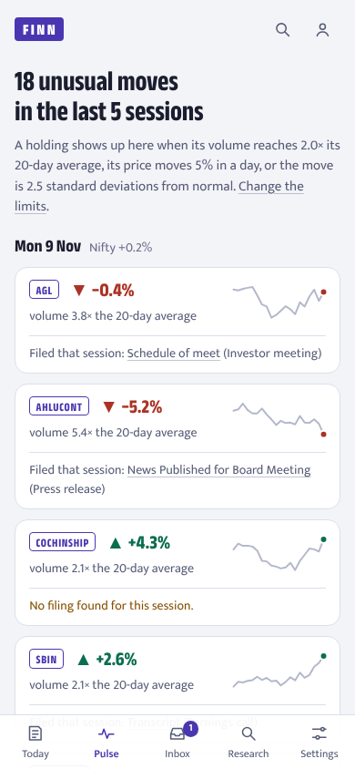
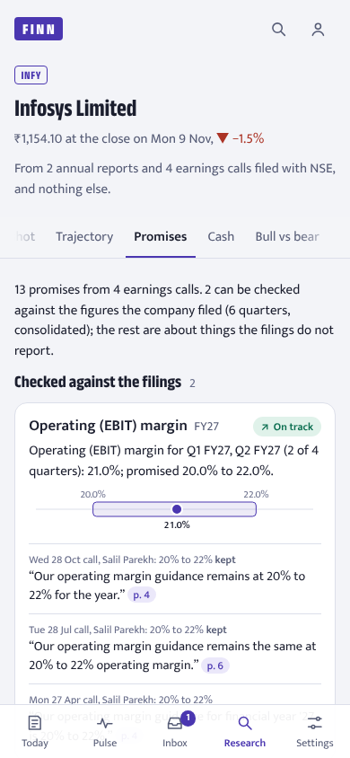
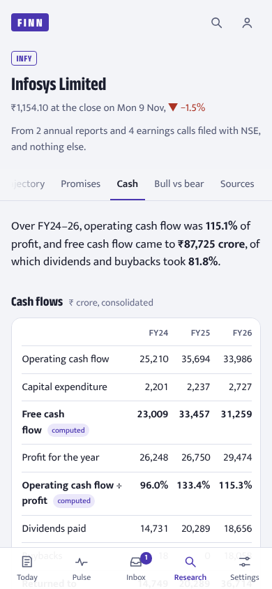
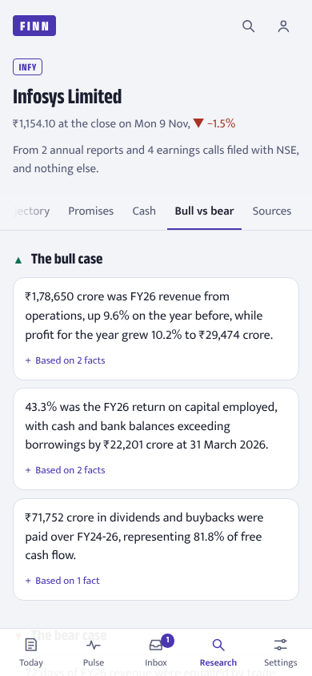

# FINN

A mobile-first investment agent for Indian equities. It reads what NSE companies file
and tells you two things: what in today's filings deserves your attention, and whether
management has done what it said it would.

**Live:** https://finn-blue.vercel.app. Open it on a phone. It starts on a demo portfolio
of 18 NSE companies. Add or remove one and your device gets its own copy; create an
account to keep it on every device. Add it to the home screen for push alerts.

| The Brief | Pulse | Promise Ledger | Cash | Bull vs bear |
|---|---|---|---|---|
|  |  |  |  |  |

## What the brief asked for, and where it is

| Requirement | In FINN |
|---|---|
| Digest of portfolio filings for a window, prioritised | **Today**: 24 hours by default; 3, 7 or 30 days, *since last visit*, or any dates up to 92 days. Every filing is grouped into an event and ranked into *Read first*, *One line* and *Routine* (folded). |
| Alerts on material announcements | Push notifications for *Read first* events, held during quiet hours (22:00–07:00) and released at 07:00; every alert also lands in the **Inbox**. |
| End-of-day volume and price alerts, configurable | **Pulse**: after the close every listed stock is checked against its 20-day volume, a daily price move and a move in standard deviations. Thresholds are set in **Settings**. Each move is tied to the filing that explains it, or marked as unexplained. |
| Management change → background of the incoming person | A people card: role, effective date, the background stated in the filing, and other boards held, each with its page. A LinkedIn search link, never a scrape. |
| Results → Revenue, EBITDA, PBT, PAT with QoQ and YoY | A results card built from the NSE XBRL filing, consolidated where filed. Code does all the arithmetic and checks it reconciles, otherwise the card says *Numbers need a look* and links the filing. |
| Research on any NSE ticker from annual reports and concall transcripts | **Research**: type any symbol. A Dossier is built in a few minutes from the last 2 annual reports and the last 4 earnings-call transcripts, and nothing else. |
| Hero example: last 4 quarters, promised vs delivered | The **Promise Ledger**: each forward-looking statement quoted word for word with its page, then checked by code against the figures the company later filed. |

Every quote and figure in a Dossier links to the page of the filing it came from, with
the words highlighted.

## The Dossier, tab by tab

- **Snapshot**: what the company does (its BRSR filing), FY figures with the year's change, and the Promise Ledger headline.
- **Trajectory**: the last eight quarters of revenue (net interest income for lenders) and profit from XBRL, and three years from the annual reports, as interactive charts.
- **Promises**: the ledger. Delivered, missed, on track, off track, too early, or *not in the filings* when the filings don't report the measure.
- **Cash**: three years of cash flow, capex, free cash flow, dividends and buybacks, balance sheet, working-capital days, interest cover, ROCE. A year is shown only if its cash flows add up to the change in cash, profit before tax less tax equals profit, and the full year matches the four quarterly XBRL filings.
- **Bull vs bear**: up to three points each way, written from a numbered list of facts code has already checked; a point that cites no fact, or states a figure its facts don't contain, is dropped.
- **Sources**: every document read, with its date and link.

Dossiers rebuild overnight when a new result, transcript or annual report arrives. When a
company files results, FINN checks them against that company's open promises, and the
outcome shows on the results card.

## How well it works

Measured from production by `evals/run_evals.py`; the full tables, with how each number is
computed, are in [`docs/EVALS.md`](docs/EVALS.md).

- **Ranking uses no model.** Every filing is ranked by rules and code. In the last 30
  days, 6 in 10 events were folded as routine and 1 in 5 made *Read first*.
- **Results cards:** every card built passed its consistency checks.
- **Statements from annual reports:** 98.5% of fiscal years read pass every accounting
  identity; every balance sheet shown balances; full-year figures match the four
  quarterly filings in 12 of 13 years compared (the one that differs is withheld).
- **Promise Ledger:** no promise is shown in words the company did not use. About 1 in 12
  candidate quotes was dropped because it was not verbatim on its page.
- **Ten companies it had never seen**, picked at random: see the generalisation table in
  `docs/EVALS.md`.
- **Cost:** models run on free tiers; at list prices a Dossier costs well under a cent.

## How it is built

```
NSE (announcements, XBRL, annual reports, bhavcopy)
        │  every 5 min / after the close / nightly
        ▼
Python worker on Modal ──► Neon Postgres ◄── Next.js PWA on Vercel (read only)
  rules, scoring, parsers,          ▲              │
  models for extraction only        └── push ──────┘ Web Push to the phone
```

- `apps/worker`: Python 3.12 on Modal: ingestion, the push pipeline, the research engine.
- `apps/web`: Next.js PWA on Vercel. It reads Postgres directly and never calls Python on
  the read path, so a page loads in one query, not one model call.
- `db/migrations`: the schema, the contract between the two. Append-only.
- `evals`, `fixtures`: the eval runner and recorded NSE payloads, PDFs' pages and model answers used by tests.

## Design rules

1. **Code computes every number.** Models extract, classify and phrase; ratios, QoQ/YoY,
   margins and scores are code with unit tests.
2. **Rules before models.** `finn/push/rules.yaml` classifies filings; models are chosen by
   tier in `models.yaml`, with a fallback when one is rate-limited.
3. **Grounded.** Every quote must be found on its page (`verify_quote`) or it is dropped.
   Prompts are closed-book.
4. **Holdings never enter a prompt.** Only public filings go to models; personalisation is
   in SQL.
5. **Never show a wrong number.** A figure that fails a check is replaced by *Numbers need
   a look* and a link to the filing.

The reasons behind these and 20 other choices are in [`docs/DECISIONS.md`](docs/DECISIONS.md).

## Run it

```bash
# worker: tests (database tests need a local Postgres with pgvector; unset, they skip)
cd apps/worker
uv sync --group dev --extra ingest --extra db --extra push --extra docs
FINN_TEST_DATABASE_URL=postgresql:///postgres uv run pytest -q
uv run ruff check . && uv run mypy

# worker: deploy schedules and build a dossier (keys live in a file outside the repo)
export FINN_ENV_FILE=~/.secrets/finn.env
uv run python -m finn.ops.envrun modal deploy -m finn.ops.modal_app
uv run python -m finn.ops.envrun modal run -m finn.ops.modal_app::dossier --symbol INFY

# web
cd apps/web && npm install && npm run build && npm start
```

Operations, schedules and health checks: [`docs/RUNBOOK.md`](docs/RUNBOOK.md).

## Limits

- NSE only. BSE-only companies and filings made only to BSE are not seen.
- Most promises are about things quarterly filings do not report (order inflow, deal
  wins, store counts); these are shown as *not in the filings* rather than guessed.
- Banks and NBFCs get the ledger and Snapshot, but their annual revenue is not compared
  with the quarterly filings, which report it differently.
- A company with no annual report on NSE gets a Dossier without the Cash and Bull vs bear tabs.
- Not investment advice: FINN reports what was filed and computes from it.

## How this was built

FINN was built in a week by one person directing Claude. How the work was steered and
checked, and what the AI got wrong along the way:
[`docs/AI_BUILD_HISTORY.md`](docs/AI_BUILD_HISTORY.md). The day-by-day record is
[`docs/BUILD_LOG.md`](docs/BUILD_LOG.md).
